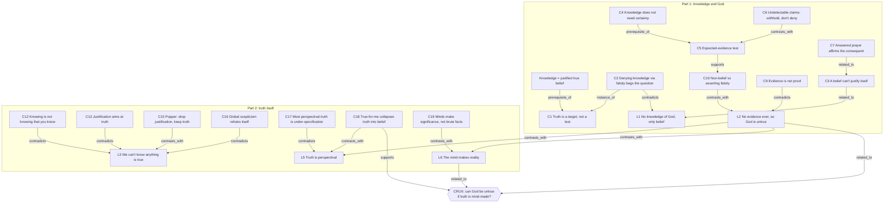

## Atom map—Knowledge and Truth

> Staging list, not a permanent note. Each row is a _candidate_ atom. Write only the ones you'll use, in your own words, link them with typed edges, then delete this file.
> Provenance: `L` rows are your stated positions. `C` rows are Claude's critique. Treat `C` rows as conjectures to test, not conclusions to copy.

---

### The Crux (Surfaced by Mapping)

The two halves of the chat pull against each other:

- First half (realist): "God is untrue"; "we can know ghosts don't exist". Both need truth to be independent of belief.
- Second half (anti-realist drift): "we can't know if anything is true"; "truth is perspectival"; "the mind makes reality".

If the second half holds, the first half loses its footing.

Q—Can I call God's existence untrue while holding that truth depends on minds?

---

### Spine

---

### Questions (yours—`Q — ` Notes, Highest Value)

| # | Question | Where it landed |
|---|---|---|
| Q1 | Can there be knowledge about God, or only belief? | The original argument begged the question; the live issue is justification. |
| Q2 | Can I know that something (ghosts, fairies) doesn't exist? | Yes, fallibly, when evidence would be expected if it did. |
| Q3 | Can answered prayer give knowledge that God intervened? | No: the inference is invalid; STEP found no effect (for prayer by strangers). |
| Q4 | Does absence of evidence make God untrue? | It supports non-belief; "untrue" needs positive grounds, concept by concept. |
| Q5 | If we only access justification, can we know anything? | Yes; we can't _certify_ knowledge, but we can have it. |
| Q6 | What does "true" mean? | Correspondence with reality; most perspectival cases dissolve when fully specified. |
| Q7 | Is truth separate from belief? | Yes, except for significance, categories and institutional facts. |
| Q8 | The crux question above. | Open. |

---

### Your Stated Positions (Provenance: Leon)

| ID | Position | Status after pressure-test |
|---|---|---|
| L1 | There is no knowledge about God, just beliefs, because God is not true. | Fails as argued (begs the question). The repaired version is C3. |
| L2 | There is no evidence for God, ever, so it is untrue. | Overstated (C9). The narrowed version is C10. |
| L3 | We can't know if anything is true; only that we believe it and our justification holds. | Contested by C12–C15; refutes itself (C16). |
| L4 | You can't know that you know nothing. | Survived. |
| L5 | Things can be true from one perspective and not another. | Mostly dissolves (C17); undercuts L1 and L2 (C18). |
| L6 | The human mind makes reality, and chooses what is significant. | Partly survived: significance yes, brute facts no (C19). |

---

### Candidate Claims (Provenance: Claude—conjectures to Test)

| ID | Claim (draft wording, rewrite before use) | Key edge |
|---|---|---|
| C1 | Truth is a constraint on knowledge, not a test anyone can run; in practice only justification can be assessed. | `prerequisite_of` ← JTB |
| C2 | Denying that a belief is knowledge because its content is false begs the question when the falsity is what's disputed. | `contradicts` L1 |
| C3 | A belief cannot be its own justification, so "my belief is my evidence" fails whether or not God exists. | `related_to` L1 (repair) |
| C4 | Knowledge does not require certainty (fallibilism). | `prerequisite_of` C5 |
| C5 | Absence of evidence counts against X in proportion to how much evidence X predicts. | `supports` C10 |
| C6 | Claims built to be undetectable can't be refuted by missing evidence; the right response is to withhold belief, not to deny. | `contrasts_with` C5 |
| C7 | "I prayed and my child recovered, so God intervened" affirms the consequent and doesn't discriminate between explanations. | `related_to` C3 |
| C8 | A hypothesis confirmed by success and excused on failure ("God's plan") can't lose, so it can't be tested. | `instance_of` C6 |
| C9 | Evidence is anything that should shift probability, not proof; "no evidence, ever" is overstated. | `contradicts` L2 |
| C10 | Not believing needs only inadequate evidence; asserting non-existence needs positive grounds, concept by concept. | `contrasts_with` L2 |
| C11 | Religious belief tracks birthplace rather than evidence, which undermines its justification. | `supports` C10 |
| C12 | Knowing P does not require knowing that you know P. | `contradicts` L3 |
| C13 | Justification aims at truth; without truth, nothing ranks one justification above another. | `contradicts` L3 |
| C14 | Every attempt at justification ends in regress, circularity or a dogmatic stopping point (Münchhausen trilemma). | `supports` C15 |
| C15 | Popper's response: drop justification, keep truth as the aim; knowledge is conjecture that survives criticism. | `contrasts_with` L3 |
| C16 | Global claims such as "nothing can be known" or "all truth is relative" refute themselves; suspension of judgement doesn't. | `contradicts` L3 |
| C17 | Most "true from one perspective" cases are under-specified claims; full specification removes the disagreement. | `contradicts` L5 |
| C18 | If "true for me" means "I believe it", truth collapses into belief and no belief can be criticised. | `supports` crux |
| C19 | Minds make significance, categories and institutional facts; they don't make brute facts. | `contrasts_with` L6 |

---

### Concepts (Search the Vault first—most Are Probably Literature-level or Already Exist)

- Justified true belief (traditional analysis) · Gettier problem
- Fallibilism · KK principle · Socratic ignorance · Pyrrhonian scepticism
- Theories of truth: correspondence, coherence, pragmatic, deflationary
- Affirming the consequent · Münchhausen trilemma
- Properly basic belief (Plantinga) · Principle of credulity (Swinburne)
- Problem of evil (evidential) · Divine hiddenness
- Institutional facts (Searle) · Popper's three worlds
- Relational quantum mechanics

### Sources Mentioned

Gettier (1963) · Plato, _Apology_ and _Theaetetus_ · Sextus Empiricus · Hume, _Enquiry_ §X (1748) · Clifford, "The Ethics of Belief" (1877) · James, "The Will to Believe" (1896) · Tarski (1944) · Flew, "Theology and Falsification" (1950) · Albert, _Treatise on Critical Reason_ (1968) · Popper, _Objective Knowledge_ (1972) · Rowe (1979) · Schellenberg (1993) · Searle, _The Construction of Social Reality_ (1995) · Sagan, _The Demon-Haunted World_ (1995) · Rovelli (1996) · Plantinga, _Warranted Christian Belief_ (2000) · Benson et al., STEP trial (2006) · Bourget & Chalmers, PhilPapers Survey (2020)

---

### Open threads—pending One-sentence Prompts from the Chat

Each answer is a ready-made steel-manned sentence for a Claim note.

1. Restate the God argument using only the justification condition, so it still works if God exists. → C3
2. Pick one God-concept: "If this God existed, I'd expect to observe ___." → C5, C6
3. "What outcome would the praying parent accept as evidence that God did not intervene?" → C8
4. Rewrite "there is no evidence for God" as a defensible claim naming the God-concept and the missing evidence. → C10
5. "If truth drops out, what makes one justification better than another?" → C13
6. Rewrite "We can't know if anything is true" so it survives being applied to itself. → L3
7. One example of perspectival truth, fully specified: does the disagreement survive? → C17
8. Sort as mind-dependent or not: _Pluto exists_ / _Pluto is a planet_ / _a £20 note is worth £20_. → C19
