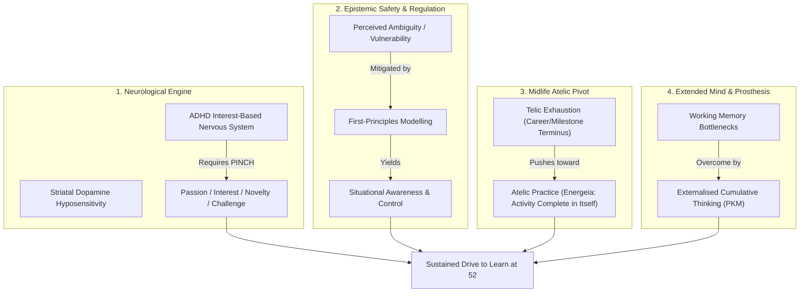
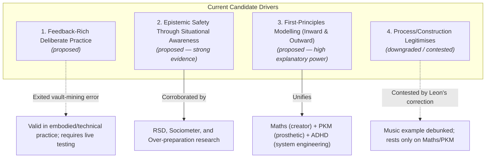

---
aliases:
- Interest Knowledge Graph Investigation Report
created: 2026-11-11T09:45:00+00:00
modified: 2026-11-11T09:45:00+00:00
permalink: llmeon/30-library/200-projects/a-portable-interest-and-pkm-knowledge-graph-investigation-report
tags:
- domain/pkm
- topic/metacognition
- topic/self-inquiry
- report
title: A Portable Interest and PKM Knowledge Graph — Investigation Report
type: project
---
# Investigation & Review: A Portable Interest and PKM Knowledge Graph

**Project Subject:** [[A Portable Interest and PKM Knowledge Graph]]  
**Companion Seed Note:** [[A Portable Interest and PKM Knowledge Graph — Interest Seed and Candidate Drivers]]  
**Date of Audit:** 11 November 2026  
**Status:** In-Depth Strategic & Empirical Review

---

## Executive Summary

The project *"A Portable Interest and PKM Knowledge Graph"* is one of the most intellectually ambitious meta-inquiries in the ProdOS vault. Formulated in mid-September 2026, its purpose is to transcend surface-level interest cataloguing and determine whether a lifetime of intense, diverse pursuits (mathematics, archery, cloud engineering, PKM, music, philosophy) is generated by a small, interacting cluster of foundational drives.

Our investigation reviewed the project specification, its auto-derived seed note, the underlying research atoms (`tmp_atoms_what-drives-a-persons-interests`, `tmp_atoms_chaos-and-situational-awareness`), and relevant cross-vault evidence ([[SoT - The Atelic Intellectual Life]], [[Why I Do a PKM and What I Think Knowledge Is For]], and [[Q — What Am I Actually Struggling With]]).

This report delivers:
1. An empirical synthesis addressing the central **Seed Question** (*"Why am I still so driven to learn at 52?"*).
2. Definitive, evidence-grounded answers to all **Ten Open Questions** posed in the project specification.
3. An audit of the **Four Candidate Drivers** currently on record.
4. An actionable, low-friction roadmap to resume the project without falling into the meta-analytical traps identified in the vault's own literature.

---

## 1. The Seed Question: Why Am I Still So Driven to Learn at 52?

> *"Why am I still so driven to learn at 52?"*

The vault provides converging evidence across four distinct dimensions to explain why this drive has persisted across decades rather than attenuating into midlife complacency:

### 1.1 The Neurological Engine: An Interest-Based Nervous System Does Not Age Out
In neurotypical adults, midlife often brings a shift toward maintenance, status conservation, and cognitive routine. However, as documented in [[MOC - ADHD (The Master Map)]] and [[SoT - The Interest-Based Nervous System in ADHD]], the ADHD brain does not run on abstract social obligation, duty, or chronological age markers. It runs on the **PINCH** criteria (Play/Passion, Interest, Novelty, Challenge, Hurry). The baseline dopamine deficit means that intellectual engagement is not a leisure choice; it is the fundamental neurochemical fuel required to engage executive function. At 52, that neurological requirement remains identical to what it was at 22.

### 1.2 Epistemic Safety: Learning as an Available Response to Chaos
As articulated in [[tmp_atoms_chaos-and-situational-awareness]], learning is a primary regulatory mechanism. When faced with complexity, opacity, or the vulnerability of being judged/failing (amplified by lifelong Rejection Sensitivity), building an exhaustive, mechanism-level model of the system creates **situational awareness**. Control is not the belief that nothing bad will happen; it is the justified confidence that one has an *available response*. Deep learning is how ambiguity is converted into safety.

### 1.3 The Atelic Pivot: Midlife Demands *Energeia* Over *Kinesis*
As synthesised in [[SoT - The Atelic Intellectual Life]] (drawing on Kieran Setiya's *Midlife* and Zena Hitz's *Lost in Thought*), midlife often reveals the hollow nature of purely *telic* goals (projects that aim at an external terminus, which cease to exist once achieved). An authentic intellectual life is *atelic* (*energeia*)—it has no terminus, is complete in every moment of its exercise, and confers dignity independent of market utility, institutional rank, or audience approval. The drive to learn at 52 is an active cultivation of non-rivalrous, self-justifying meaning.

### 1.4 Cognitive Scaffolding: The Cumulative Conversation with the Self
As stated directly in [[Why I Do a PKM and What I Think Knowledge Is For]]:
> *"For an ADHD brain specifically, it converts cyclical thinking (spinning in place, losing state) into cumulative thinking: I get to have conversations with my past self."*

The drive persists because the externalised thinking system (ProdOS) has finally made progress permanent. Learning is no longer dissipated into the sand of working memory deficits; it now accumulates.

---

## 2. Answers to the Ten Open Questions

The project specification poses ten rigorous methodological questions (lines 304–314). Here are direct, vault-grounded investigations and answers for each:

### Q1: Is "first-principle driver" the right name, or does "candidate generative drive" better preserve uncertainty and plurality?
* **Answer:** Adopt **"Candidate Generative Drive"**.
* **Rationale:** "First-principle" borrows physicalist and axiomatic language, falsely implying a single, immutable, deductive foundation at the base of human behaviour. In contrast, the project's own Principle #6 assumes many-to-many causation, context-dependence, and dynamic evolution over time. "Candidate Generative Drive" preserves scientific humility (`candidate`), recognises that underlying motives actively produce diverse visible manifestations (`generative`), and avoids premature reductionism.

### Q2: What counts as sufficient evidence that a candidate is useful rather than merely narratively satisfying?
* **Answer:** A candidate is useful if and only if it exhibits **Discriminative Specificity**, **Counterfactual Sensitivity**, and **Prospective Predictive Power**.
* **Rationale:** Narrative plausibility is cheap—any clever mind can weave a convincing post-hoc story connecting two hobbies. Per [[How to Interrogate a Candidate Interest Driver]], a driver is valid when:
  1. *Negative Discrimination:* It successfully explains why superficially similar activities *fail* to hold attention (e.g. why mathematics appeals as engineering/pattern discovery, but commercial accounting leaves you cold).
  2. *Perturbation Check:* Modifying the core affordance (e.g. removing real-time sensory feedback from archery, or eliminating mechanism-level visibility from cloud engineering) predictably collapses engagement.
  3. *Advance Prediction:* It predicts in advance which aspects of an unfamiliar pursuit will attract or repel you.

### Q3: Is there one dominant drive, a small interacting cluster, or different configurations across contexts and life stages?
* **Answer:** A **triangular interacting cluster**, dynamically weighted by context.
* **Rationale:** The vault's evidence firmly refutes a single master cause. Three distinct attractors emerge across the notes:
  1. **Epistemic Safety / Situational Awareness:** The drive to eliminate vulnerability and paralysis through deep causal comprehension (active in professional, high-stakes, or ambiguity-heavy environments).
  2. **Embodied / Feedback-Rich Mastery:** The drive for immediate, physical or systemic feedback loops where effort converts visibly into competence (active in archery, code debugging, and musical instrument practice).
  3. **Aesthetic Architecture & Compression:** The contemplative drive to find minimal, elegant, unifying order in complex systems (active in mathematics, PKM structure, and philosophy).
  *Contextual configuration:* Under stress or threat of evaluation, Drive 1 dominates; in protected private focus, Drive 2 dominates; in reflective solitude, Drive 3 takes over.

### Q4: Which observations can be collected prospectively without turning life into continuous self-surveillance?
* **Answer:** **Episode-Boundary Micro-Logs** attached to existing inflection points, not ongoing tracking.
* **Rationale:** In [[Q — What Am I Actually Struggling With]], the vault proved that ambitious measurement protocols fail 100% of the time, whereas single-line captures attached to existing cues succeed. Never attempt continuous tracking. Instead, log *only* when:
  1. A project or hobby abruptly stalls or is abandoned (a 30-second note: *"What broke the pull? Loss of feedback, excess ambiguity, or forced performance?"*).
  2. An intense, unplanned flow state concludes (*"What specific affordance kept me locked in?"*).
  3. During the Friday Weekly Command Centre (60 seconds to note the week's highest-pull activity).

### Q5: How should confidence and temporal change be represented without creating false numerical precision?
* **Answer:** Use **Ordinal Epistemic Statuses** and **Event-Linked Delta Annotations**.
* **Rationale:** Pseudo-mathematical scoring (e.g. "Confidence: 74.2%") creates the illusion of rigour. Maintain the five qualitative states already defined in the project: `proposed` → `supported` → `contested` → `provisional` → `retired`. Track temporal shifts strictly via dated delta notes: e.g. `[modified:: 2026-11-11, delta:: "downgraded due to counter-evidence in live music episode"]`.

### Q6: When is a recurring pattern a drive, a value, a need, a coping strategy, an identity commitment, a habit, or merely an affordance?
* **Answer:** Disentangle these layers using this clean operational taxonomy:

| Layer | Definition | Vault Example |
|---|---|---|
| **Affordance** | An objective property of an activity or system (what it permits). | Recurve archery provides instant physical arrow-impact feedback. |
| **Habit** | An automated behavioral loop triggered by contextual cues without deliberate valuation. | Opening Obsidian when sitting at the desk. |
| **Coping Strategy** | A reactive defense mechanism deployed to mitigate negative affect or threat. | Over-preparing technical documentation to inoculate against RSD/shame. |
| **Need** | A non-negotiable psychological baseline requirement. | Autonomy, competence, and relatedness (Self-Determination Theory). |
| **Value** | A consciously endorsed principle regarding what *ought* to matter. | The belief that intellectual life has atelic, intrinsic worth independent of economic output. |
| **Identity Commitment** | A self-concept structure that guides role behavior and social belonging. | "I am an engineer / creator, not merely an operator / mechanic." |
| **Drive** | An endogenous motivational tension drawing attention toward specific qualitative experiences. | The visceral impulse to construct causal mental models from opaque chaos. |

### Q7: Can two competing explanations remain useful without being resolved into one?
* **Answer:** **Yes.** Dual-motivation and compensatory dynamics are normal in complex cognition.
* **Rationale:** For instance, deep technical exploration can simultaneously be an authentic expression of aesthetic curiosity *and* a neurotic defense against feeling inadequate or being caught unawares. Forcing an artificial verdict ("Is it curiosity OR is it fear?") creates false dichotomy. The fruitful question is: *What are the relative proportions under varying conditions of stress and social exposure?*

### Q8: Which external traces can test memory-based accounts while respecting privacy?
* **Answer:** Leverage existing digital exhaust already tracked in the vault ecosystem:
  1. **Git Commit History:** Diff filters reveal actual creation, modification, and deletion patterns (e.g. the workbench note deletions discovered in `Q — What Am I Actually Struggling With`).
  2. **Todoist Completion Clusters:** Distinguish between genuine daily task execution and burst bulk-dismissals.
  3. **Reading Logs & Highlight Timestamps:** BookFusion and Calibre logs prove which topics were actively consumed versus merely aspirational.
  4. **Shell/Coding Activity:** Command histories and project commits provide an unvarnished trace of actual technical focus.

### Q9: At what point should a candidate driver reshape the downstream interest taxonomy or decision process?
* **Answer:** When it reaches **`provisional` status** and passes the **"Pre-Commitment Filter Test"**.
* **Rationale:** A driver should not alter your taxonomy while in `proposed` or `supported` stages. Once it reaches `provisional` (demonstrating cross-domain reach, temporal stability, and confirmed predictions), operationalise it as a filter for new commitments:
  > *Before committing to a new project or study path, ask: "Does this opportunity provide the core affordances of my proven drivers (e.g. clear feedback loops, mechanism-level transparency), or is it an attractive topic with affordances that historically trigger abandonment?"*

### Q10: How will the project detect when analysis itself is satisfying one of the drives it is attempting to study?
* **Answer:** By monitoring the **Execution-to-Architecture Ratio** and watching for the "Architect's Trap".
* **Rationale:** As identified in [[Claim - Analysing One's Own Avoidance Can Itself Be an Instance of the Avoidance It Describes]], building elaborate meta-frameworks produces identical dopamine and relief signatures to actual progress while avoiding real-world friction.
* **The Diagnostic Red Flag:** If the graph model adds node types, edge schemas, and taxonomy debates, but fails to execute a single live contrast inquiry with real life episodes, the project is actively functioning as an epistemic avoidance engine.
* **The Guardrail:** Enforce the rule from [[The sophistication is a bug not a feature]]: *No architectural refinement is permitted without at least one empirical data point collected first.*

---

## 3. Status Audit of Proposed Candidate Drivers

The companion seed note ([[A Portable Interest and PKM Knowledge Graph — Interest Seed and Candidate Drivers]]) catalogues four candidate drivers proposed in September 2026. Here is their current evidential status:

### Driver 1: Feedback-Rich Deliberate Practice (`proposed`)
* **Core Hypothesis:** Preference for pursuits with rapid, interpretable feedback and visible progression (DevOps, archery, PKM, automation).
* **Current Status:** Solid conceptually, but complicated by the vault-mining observation that professional DevOps work had zero reflective writing in the vault. As Leon clarified, this reflection happens on the job, not in Obsidian.
* **Next Test:** Check whether high-feedback activities that lack intellectual depth or creative agency (e.g. arcade gaming, repetitive physical drills) hold attention. If not, feedback alone is insufficient; it must be coupled with structural progression.

### Driver 2: Epistemic Safety Through Situational Awareness (`proposed`)
* **Core Hypothesis:** The impulse to understand underlying mechanisms is rooted in converting perceived vulnerability/threat into agentic control.
* **Current Status:** Extremely well-grounded in cross-vault evidence ([[tmp_atoms_chaos-and-situational-awareness]], [[tmp_atoms_psychology-of-over-preparing]]). Accurately accounts for deep dives into cloud architecture, networking protocols, security, and ADHD neurobiology.
* **Next Test:** Test the boundary: *Does this pull persist when there is absolutely zero risk, zero audience, and no possibility of failure?* (If yes, pure curiosity or aesthetic order is operating independently).

### Driver 3: First-Principles Modelling, Turned Inward and Outward (`proposed`)
* **Core Hypothesis:** A unifying drive to build legible, mechanism-level models of systems—both external technical systems (cloud, Kubernetes, physics, logic) and internal human systems (ADHD as an engineering problem `B = f(P, E)`, willpower, ProdOS).
* **Current Status:** High explanatory power. Accounts for the striking stylistic divide in the vault: technical domains are organised as objective architecture, while personal practices are reflected upon as behavioral engineering.
* **Next Test:** Identify systems you had ample opportunity and capacity to model, but deliberately ignored (e.g. financial market speculation, pure history/chronology). What made those systems unappealing?

### Driver 4: Process/Construction Legitimises, Consumption Needs Defending (`contested / downgraded`)
* **Core Hypothesis:** The assumption that creating/building is the only valid mode of engagement, making pure appreciation/consumption feel suspect.
* **Current Status:** Downgraded following Leon's correction on 15 September 2026. The music notes were not a philosophical defense of passive listening, but notes from a conversation with his daughter about artistic authenticity. Leon was historically a full-time practising musician.
* **Next Test:** Re-elicit the true history of music practice. Why did daily playing stop, and what took its place?

---

## 4. Architectural & Schema Conformance

* **Project File:** [[A Portable Interest and PKM Knowledge Graph]] is structurally sound, conforms to project guidelines, and provides clear principles and graph models.
* **Seed Note:** [[A Portable Interest and PKM Knowledge Graph — Interest Seed and Candidate Drivers]] currently has `conformant: false` due to missing schema fields (`definition`, `distinguishes_from`, `used_in_claims`). Because it is an empirical working log rather than a canonical concept card, its metadata can be reconciled or aligned under a project log schema.

---

## 5. Actionable Roadmap: Moving from Theory to Live Discovery

To prevent the project from becoming a static monument of self-inquiry, execute these three concrete, low-activation steps:

1. **Step 1: The First Triad Comparison (Live Conversation)**
   Per Method §2, take three concrete interests and answer one question:
   > *Between **Archery**, **Mathematics**, and **DevOps/Cloud Infrastructure**: in what essential way are two of these providing the exact same experience, while the third is fundamentally different?*
   *(This immediately isolates the affordances that matter without premature categorisation.)*

2. **Step 2: Re-Elicit the Missing Music History**
   Answer the two standing questions from 15 September:
   > - *When did daily music practice stop, and what changed in your environment or life stage?*
   > - *Did technical systems engineering absorb the cognitive and aesthetic space music once occupied?*

3. **Step 3: Establish the Single-Line Episode Rule**
   Do not build a tracking database. When an activity produces either deep, effortless immersion or sudden, jarring resistance, jot one sentence in the daily note:
   `Interest probe: [Activity] — felt [aliveness/friction] because of [immediate feedback / lack of clear model].`
